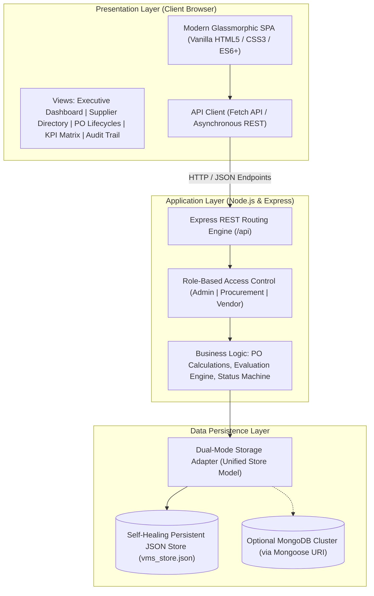
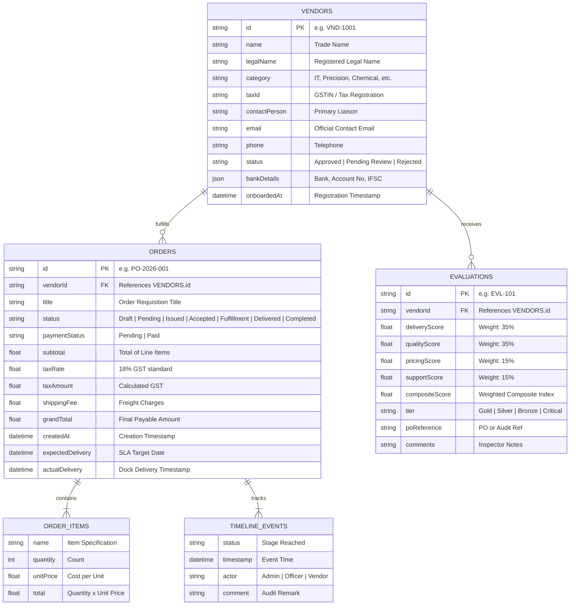
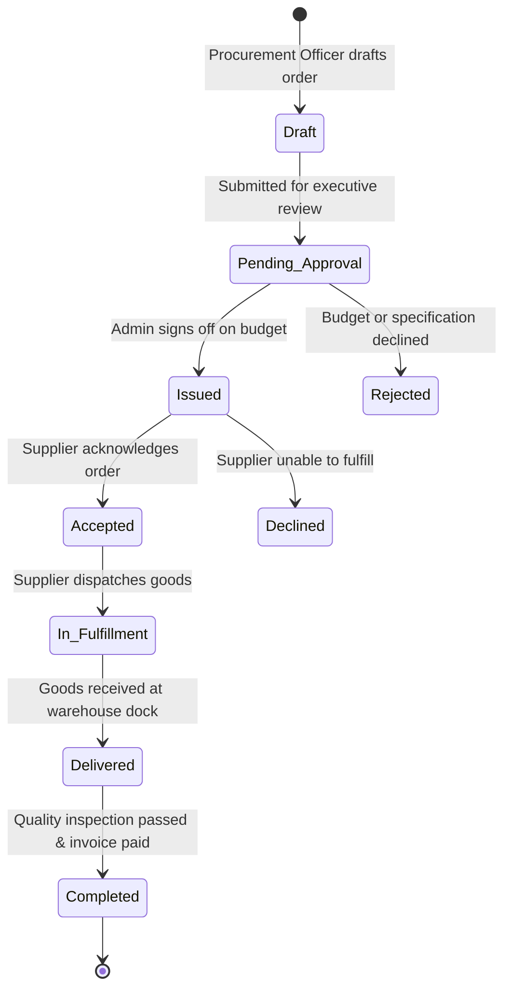

# Vendor Management System (VMS) - Architectural Concept & Technical Specification

> **Course / Review Reference**: Full Stack Development (FSD) Project &bull; Combined Review 1 & 2  
> **System Scope**: Supplier Onboarding, Performance KPI Scoring, and Purchase Order Lifecycle Automation.

---

## 1. System Overview & Problem Statement

Modern enterprise supply chains face three critical bottlenecks:
1. **Unregulated Supplier Onboarding**: Fragmented documentation, lack of GSTIN/tax verification, and delayed credential approvals.
2. **Subjective Vendor Appraisals**: Absence of quantifiable, weighted KPI scorecards for assessing delivery punctuality, quality pass rates, and commercial value.
3. **Opaque Purchase Order Lifecycles**: Lack of real-time visibility between procurement requisition, vendor acknowledgment, transit tracking, dock receiving, and invoice settlement.

The **Vendor Management System (VMS)** resolves these challenges by providing a unified, three-tier procurement portal that streamlines end-to-end interactions between corporate buyers, procurement officers, and external suppliers.

---

## 2. Three-Tier Architectural Topology

---

## 3. Entity-Relationship (ER) Data Model

---

## 4. Purchase Order Lifecycle State Machine

---

## 5. Performance Evaluation Mathematical Model

The composite vendor score $S_{composite}$ is calculated using an enterprise multi-criteria decision formula:

$$S_{composite} = (0.35 \times S_{delivery}) + (0.35 \times S_{quality}) + (0.15 \times S_{pricing}) + (0.15 \times S_{support})$$

Where each sub-metric is scored on a standardized $1.0 - 5.0$ scale:
- **$S_{delivery}$**: Punctuality against agreed PO expected delivery dates.
- **$S_{quality}$**: Spec compliance, dimensional tolerances, and incoming defect rates.
- **$S_{pricing}$**: Cost competitiveness against market benchmarks.
- **$S_{support}$**: Responsiveness of vendor customer support and SLA adherence.

### Tier Classification Matrix:
| Score Range | Tier Classification | Procurement Action |
| :--- | :--- | :--- |
| **$4.50 - 5.00$** | 🥇 **Gold (Preferred)** | First choice for direct PO issuance & long-term contracts |
| **$3.80 - 4.49$** | 🥈 **Silver (Approved)** | Qualified active supplier for competitive bidding |
| **$2.50 - 3.79$** | 🥉 **Bronze (Under Review)** | Monitored status; conditional orders only |
| **$< 2.50$** | ⚠️ **Critical (At Risk)** | Suspended from active procurement pipeline |

---

## 6. Role-Based Access Control (RBAC) Matrix

| Feature / Action | Admin | Procurement Officer | Vendor / Supplier |
| :--- | :---: | :---: | :---: |
| **View Dashboard & KPI Analytics** | ✅ | ✅ | ❌ (Scorecard Only) |
| **Onboard New Suppliers** | ✅ | ✅ | ✅ (Self-Register) |
| **Approve / Reject Supplier Dossier** | ✅ | ✅ | ❌ |
| **Draft Purchase Orders** | ✅ | ✅ | ❌ |
| **Approve Financial Requisitions** | ✅ | ❌ | ❌ |
| **Acknowledge / Accept Issued PO** | ❌ | ❌ | ✅ |
| **Update Transit & Fulfillment** | ❌ | ❌ | ✅ |
| **Confirm Dock Delivery** | ✅ | ✅ | ❌ |
| **Settle Payments & Close PO** | ✅ | ❌ | ❌ |
| **Submit Performance Appraisals** | ✅ | ✅ | ❌ |
| **Export Audit Logs & CSV Reports**| ✅ | ✅ | ❌ |

---

## 7. Viva & Review Discussion Points

1. **Why use dual persistence (File-backed JSON + MongoDB support)?**
   - Eliminates environment setup dependencies for presentation evaluators. If MongoDB is inactive, the system functions seamlessly with persistent atomic writes.
2. **How is data integrity maintained in PO calculations?**
   - Totals, GST (18%), and line totals are strictly calculated server-side in `store.js` regardless of client payload to prevent financial manipulation.
3. **What prevents unauthorized lifecycle transitions?**
   - The state machine restricts invalid jumps (e.g., an order cannot jump directly from `Draft` to `Delivered`). Every state change appends an immutable timeline log.
